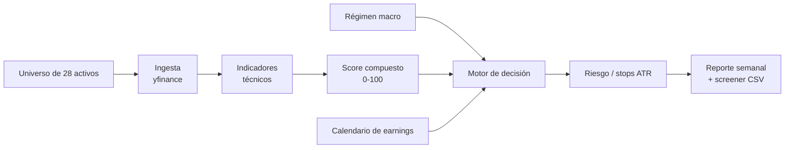

# Framework Educativo de Swing Trading Cuantitativo

[](https://github.com/LuisFernandoTovarFlores/educational-quant-trading/actions/workflows/ci.yml)
[](LICENSE)
[](pyproject.toml)

Framework educativo de investigación, basado en reglas y reproducible, para
swing trading semanal de acciones y ETFs líquidos de EE. UU. Descarga datos
diarios, calcula indicadores técnicos, rankea un universo de 28 activos, aplica
filtros de régimen de mercado y genera recomendaciones transparentes de
**Mantener / Rotar** con stops basados en ATR y reportes en Markdown.

> **⚠️ Solo para investigación y educación — no es asesoría financiera.**
> Este proyecto no ejecuta órdenes, no garantiza rendimientos y puede perder
> dinero. No ha sido validado con un backtest. No operes con capital real
> basándote únicamente en este software. Ver [Limitaciones](docs/LIMITATIONS.md)
> y el [propósito educativo completo](EDUCATIONAL_PURPOSE.md).

**Idiomas:** [English](README.md) | Español

---

## Qué es este proyecto

- Un **pipeline transparente basado en reglas** que puedes leer, testear y modificar.
- Un **entorno de investigación** para scoring técnico, filtros de régimen y reglas de riesgo.
- Un **generador de reportes** que convierte una foto semanal del mercado en una decisión documentada.
- Un **punto de partida** para experimentos de backtesting y contabilidad de cartera.

## Qué no es

- No es un bróker, motor de ejecución ni bot de trading.
- No es una fuente de alpha validada ni una estrategia rentable.
- No es asesoría financiera, fiscal ni de inversión.

---

## Características

- **Universo de 28 activos**: mega-caps, ETFs sectoriales, ETFs apalancados e
  inversos 3x y proxies defensivos (`SGOV`, `BIL`, `SHY`).
- **Score compuesto 0–100** con pesos configurables de momentum, tendencia,
  volatilidad, liquidez y régimen.
- **Filtro de régimen** (`RISK_ON`, `NEUTRAL`, `RISK_OFF`) con VIX, medias
  móviles de SPY, curva de tasas y DXY.
- **Motor de decisión** con hurdle de score, filtro EMA21, ratio R:B mínimo y
  cap de idoneidad.
- **Stops por ATR** con multiplicadores por categoría (2.5x estándar, 3.0x para
  ETFs apalancados 3x) y cap de riesgo del 12%.
- **Filtro de earnings** para la ventana de lunes a viernes de la semana entrante.
- **Reporte semanal** en Markdown y **screener** en CSV.
- **Reporte ejecutivo opcional** con fundamentales, sentimiento de noticias y
  contexto macro.
- **Contabilidad de cartera** con comisiones configurables y retorno acumulado.
- **Suite de tests offline** que corre en pocos segundos.

---

## Inicio rápido

**Requisitos:** Python 3.10+ y conexión a internet para descargar datos.

```bash
git clone https://github.com/LuisFernandoTovarFlores/educational-quant-trading.git
cd educational-quant-trading

python -m venv .venv
source .venv/bin/activate        # Windows: .venv\Scripts\activate
pip install -e ".[dev]"

# Crea un portafolio de demostración (nunca commitees el real)
cp examples/portfolio.example.json state/portfolio.json

# Claves opcionales para noticias y macro
cp .env.example .env
# edita .env con tus claves de Finnhub / Marketaux / FRED

# Ejecuta el pipeline semanal
python -m src.run_weekly --skip-earnings
```

Archivos generados:

| Archivo | Contenido |
| --- | --- |
| `output/report_YYYY-WW.md` | Reporte semanal de decisión |
| `output/screener_YYYY-WW.csv` | Universo rankeado con stops |
| `output/executive_YYYY-WW.md` | Reporte ejecutivo opcional |
| `output/dossier.json` | Datos estructurados del reporte ejecutivo |

> **Datos:** los OHLCV descargados, los reportes y `state/portfolio.json` están
> en `.gitignore`. No los commitees.

---

## Cómo funciona



1. **Ingesta** de datos OHLCV diarios y validación de columnas.
2. **Cálculo** de EMA9/21, ATR14, RSI14, retornos, volatilidad, ratio de volumen
   y distancias a máximos/mínimos.
3. **Scoring** de cada activo y ranking del universo.
4. **Detección de régimen** con VIX, SPY vs medias de 50/200 días, spread
   10Y–2Y y DXY.
5. **Decisión** HOLD, ROTATE o rotación forzada a cash proxy / activo estándar.
6. **Reporte** de la decisión, top de candidatos, stops, earnings y checklist
   pre-market.

Más detalle: [Arquitectura](docs/ARCHITECTURE.md) · [Estrategia](docs/STRATEGY.md).

---

## Estrategia en una página

| Componente | Default | Fuente de verdad |
| --- | --- | --- |
| Peso momentum | 30% | `config/settings.yaml` |
| Peso tendencia | 25% | `config/settings.yaml` |
| Peso volatilidad | 20% | `config/settings.yaml` |
| Peso liquidez | 10% | `config/settings.yaml` |
| Peso régimen | 15% | `config/settings.yaml` |
| Hurdle de rotación | +15 puntos | `decision.rotate.score_hurdle_points` |
| R:B mínimo | 2:1 | `decision.rotate.min_risk_reward_ratio` |
| Stop estándar | 2.5 × ATR14 | `risk.stop_loss.multipliers.standard` |
| Stop apalancado 3x | 3.0 × ATR14 | `risk.stop_loss.multipliers.leveraged_3x` |
| Cap de riesgo | 12% | `risk.stop_loss.max_risk_pct` |
| Comisión | 0.20% | `costs.commission_pct` |
| Modo de comisión | semanal | `costs.charge_on` |

**HOLD** exige: precio sobre EMA21, sin earnings la semana entrante, score en el
top 30% y stop dentro del cap de riesgo.

**ROTATE** exige: que la posición actual incumpla una condición de HOLD y que el
mejor candidato supere el score actual por al menos 15 puntos, esté sobre EMA21,
sea apto y ofrezca al menos 2:1 de R:B.

> Estas reglas son una **hipótesis de diseño**, no una ventaja demostrada. Los
> parámetros no están calibrados out-of-sample. Ver [Limitaciones](docs/LIMITATIONS.md).

---

## Configuración

Edita [`config/settings.yaml`](config/settings.yaml) para los parámetros
numéricos y [`config/universe.py`](config/universe.py) para el universo.

| Clave | Significado |
| --- | --- |
| `project.horizon_weeks` | Horizonte de referencia (8 semanas) |
| `costs.commission_pct` | Porcentaje de comisión |
| `costs.charge_on` | `weekly` (una vez por semana ISO) o `rotation` |
| `decision.hold.min_score_percentile` | Percentil mínimo para mantener |
| `decision.rotate.score_hurdle_points` | Ventaja mínima de score para rotar |
| `decision.rotate.min_risk_reward_ratio` | Ratio R:B mínimo |
| `risk.stop_loss.multipliers.*` | Multiplicadores ATR por categoría |
| `risk.stop_loss.max_risk_pct` | Cap de idoneidad |
| `fx.usd_mxn` | Tipo de cambio de referencia para sizing |
| `data.period` | Período por defecto de yfinance |
| `reporting.output_dir` | Directorio de reportes |

Las claves de API son opcionales y viven en `.env` (nunca se commitea):

| Variable | Uso |
| --- | --- |
| `FINNHUB_API_KEY` | Fundamentales y noticias de empresa |
| `MARKETAUX_API_KEY` | Noticias con sentimiento |
| `FRED_API_KEY` | Tasas del Tesoro (opcional; fallback a yfinance) |

---

## Línea de comandos

```bash
# Pipeline semanal
python -m src.run_weekly
python -m src.run_weekly --period 6mo --skip-earnings --no-save-data

# Reporte ejecutivo de la posición actual
python -m src.executive_report
python -m src.executive_report --portfolio state/portfolio.json --output-dir output
```

Tras `pip install -e .`, los comandos también están disponibles como:

```bash
swing-trading
swing-trading-report
```

| Flag | Efecto |
| --- | --- |
| `--period` | Período de yfinance (`1y`, `6mo`, ...) |
| `--skip-earnings` | Omite la consulta de earnings (menos llamadas) |
| `--no-save-data` | No guarda CSVs crudos en `data/raw` |
| `--no-commission` | No cobra la comisión semanal en esta ejecución |

---

## Estructura del proyecto

```text
.
├── .github/                 # CI, plantillas de issues/PR, Dependabot
├── config/
│   ├── loader.py            # carga settings.yaml
│   ├── secrets.py           # carga .env
│   ├── settings.yaml        # parámetros de estrategia y riesgo
│   └── universe.py          # universo de 28 activos
├── docs/                    # arquitectura, estrategia, limitaciones, roadmap
├── examples/                # portafolio, reporte y screener de ejemplo
├── src/
│   ├── accounting.py        # comisiones y retorno
│   ├── decision.py          # motor único HOLD/ROTATE
│   ├── earnings.py          # ventana de earnings
│   ├── executive_report.py  # reporte ejecutivo Jinja2
│   ├── fundamentals.py      # fundamentales de acciones/ETFs
│   ├── indicators.py        # indicadores técnicos
│   ├── ingest.py            # ingesta yfinance
│   ├── macro.py             # régimen de mercado
│   ├── narrative.py         # dossier del reporte ejecutivo
│   ├── news.py              # noticias y sentimiento
│   ├── paths.py             # rutas ancladas a la raíz
│   ├── pipeline.py          # helpers de ingesta + ranking
│   ├── report.py            # reporte semanal y screener
│   ├── risk.py              # stops ATR y validaciones
│   ├── run_weekly.py        # CLI orquestador
│   ├── scoring.py           # score compuesto
│   └── technicals_deep.py   # MACD, ADX, Bollinger, Supertrend, OBV
├── templates/               # plantilla del reporte ejecutivo
├── tests/                   # tests offline + integración
├── .env.example
├── .pre-commit-config.yaml
├── CHANGELOG.md
├── CONTRIBUTING.md
├── EDUCATIONAL_PURPOSE.md
├── LICENSE
├── Makefile
├── pyproject.toml
├── README.md
├── README.es.md
└── SECURITY.md
```

---

## Tests

```bash
# Suite offline (sin red, determinista)
python -m pytest -q

# Incluye tests de integración (descargan datos, requieren internet)
python -m pytest -q -m integration

# Con cobertura
python -m pytest --cov=src --cov=config --cov-report=term-missing
```

La suite offline cubre indicadores, scoring, reglas de decisión, riesgo,
contabilidad, generación de reportes y regresiones. Los tests de integración
están marcados y se excluyen por defecto para que CI no dependa de Yahoo o
Finnhub.

Lint y formato:

```bash
ruff check .
ruff format .
pre-commit install
pre-commit run --all-files
```

---

## Limitaciones

Este proyecto es un **framework de investigación**, no un sistema de producción.
Limitaciones principales:

- **Sin backtest** ni validación out-of-sample de los parámetros.
- **Sin slippage, impacto de mercado ni modelo de liquidez.**
- **Riesgo FX no cubierto**; `fx.usd_mxn` es un supuesto de referencia.
- **La calidad de datos depende de yfinance**, que no es un feed oficial.
- **Concentración del 100%** y ETFs apalancados 3x pueden producir drawdowns severos.
- **Sin corrección de sesgo de supervivencia**; el universo está elegido a mano.

Lista completa en [docs/LIMITATIONS.md](docs/LIMITATIONS.md).

---

## Roadmap

- [x] Higiene open source: licencia, CI, docs, ejemplos, empaquetado.
- [x] Corrección de bugs críticos de contabilidad, stops y motor de decisión.
- [ ] Backtesting walk-forward con comisiones y slippage.
- [ ] Benchmark contra SPY/QQQ (CAGR, Sharpe, max drawdown).
- [ ] Contabilidad de cartera consciente del FX.
- [ ] Adaptador de paper trading agnóstico de bróker.
- [ ] Mocking completo de los tests de integración.

Ver [docs/ROADMAP.md](docs/ROADMAP.md).

---

## Contribuir

Las contribuciones son bienvenidas. Lee [CONTRIBUTING.md](CONTRIBUTING.md) y
[CODE_OF_CONDUCT.md](CODE_OF_CONDUCT.md) antes de empezar.

Buenas primeras contribuciones:

- Añadir un test para un caso límite no cubierto.
- Mejorar un docstring o la documentación ES/EN.
- Reemplazar un supuesto hardcodeado por una clave de configuración.
- Añadir un mock a un test de integración.

Seguridad: ver [SECURITY.md](SECURITY.md). **Nunca abras un issue público con una
API key o datos reales de tu cartera.**

---

## Licencia

Publicado bajo la [Licencia MIT](LICENSE).

Puedes usar, modificar y distribuir este software siempre que incluyas el aviso
de copyright y el permiso. El software se entrega **sin garantía de ningún tipo**.

---

## Agradecimientos

- Notas de investigación de estrategias: [docs/STRATEGY_RESEARCH.md](docs/STRATEGY_RESEARCH.md).
- Datos de mercado: [yfinance](https://github.com/ranaroussi/yfinance).
- Noticias y fundamentales: Finnhub, Marketaux y FRED (opcionales).
- Construido con Python, pandas, NumPy, Jinja2 y PyYAML.

> **Aviso final:** operar en bolsa implica un riesgo sustancial de pérdida. Los
> autores y contribuidores no son responsables de pérdidas financieras derivadas
> del uso de este software. Haz tu propia investigación y consulta a un
> profesional licenciado.
