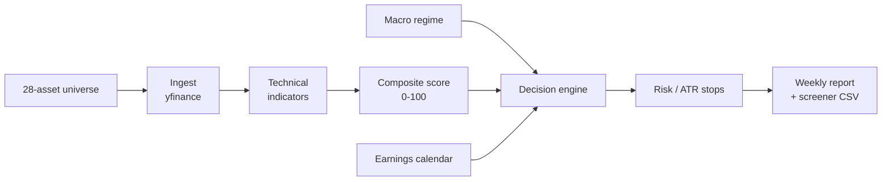

# Educational Quantitative Swing Trading Framework

[](https://github.com/LuisFernandoTovarFlores/educational-quant-trading/actions/workflows/ci.yml)
[](LICENSE)
[](pyproject.toml)

An educational, rules-based and reproducible research framework for weekly swing
trading of liquid US equities and ETFs. It ingests daily market data, computes
technical indicators, ranks a 28-asset universe, applies market-regime filters,
and produces transparent **Hold / Rotate** recommendations with ATR-based stops
and Markdown reports.

> **⚠️ Educational research only — not investment advice.**
> This project does not execute orders, does not guarantee returns, and can lose
> money. It has not been validated with a backtest. Never trade real capital
> based only on this software. See [Limitations](docs/LIMITATIONS.md) and the
> full [educational purpose statement](EDUCATIONAL_PURPOSE.md).

**Languages:** English | [Español](README.es.md)

---

## What this project is

- A **transparent, rule-based pipeline** you can read, test and modify.
- A **research sandbox** for technical scoring, regime filters and risk rules.
- A **report generator** that turns a weekly snapshot into a decision memo.
- A **starting point** for backtesting and portfolio-accounting experiments.

## What this project is not

- Not a broker, execution engine or trading bot.
- Not a validated alpha source or a profitable strategy.
- Not financial, tax or investment advice.

---

## Features

- **28-asset universe**: mega-caps, sector ETFs, 3x leveraged/inverse ETFs and
  defensive cash proxies (`SGOV`, `BIL`, `SHY`).
- **Composite 0–100 score** with configurable momentum, trend, volatility,
  liquidity and regime weights.
- **Market-regime filter** (`RISK_ON`, `NEUTRAL`, `RISK_OFF`) driven by VIX, SPY
  moving averages, the yield curve and DXY.
- **Decision engine** with a strict score hurdle, EMA21 trend filter,
  risk/reward minimum and suitability cap.
- **ATR-based stops** with category multipliers (2.5x standard, 3.0x for 3x
  leveraged ETFs) and a 12% risk cap.
- **Earnings filter** for the next Monday–Friday window.
- **Weekly report** (Markdown) and **screener** (CSV).
- **Optional executive report** with fundamentals, news sentiment and macro
  context.
- **Portfolio accounting** with configurable commissions and return tracking.
- **Offline test suite** that runs in a few seconds.

---

## Quickstart

**Requirements:** Python 3.10+, internet access for market data.

```bash
git clone https://github.com/LuisFernandoTovarFlores/educational-quant-trading.git
cd educational-quant-trading

python -m venv .venv
source .venv/bin/activate        # Windows: .venv\Scripts\activate
pip install -e ".[dev]"

# Create a demo portfolio (never commit your real one)
cp examples/portfolio.example.json state/portfolio.json

# Optional API keys for news / macro data
cp .env.example .env
# edit .env with your Finnhub / Marketaux / FRED keys

# Run the weekly pipeline
python -m src.run_weekly --skip-earnings
```

Generated files:

| File | Content |
| --- | --- |
| `output/report_YYYY-WW.md` | Weekly decision report |
| `output/screener_YYYY-WW.csv` | Full ranked universe with stops |
| `output/executive_YYYY-WW.md` | Optional executive report |
| `output/dossier.json` | Structured data used by the executive report |

> **Data note:** downloaded OHLCV data, generated reports and
> `state/portfolio.json` are git-ignored. Do not commit them.

---

## How it works



1. **Ingest** daily OHLCV data and validate the columns.
2. **Compute** EMA9/21, ATR14, RSI14, returns, volatility, volume ratio and
   distances to highs/lows.
3. **Score** every asset and rank the universe.
4. **Detect the regime** from VIX, SPY vs 50/200-day MAs, the 10Y–2Y spread and
   DXY.
5. **Decide** HOLD, ROTATE, or a forced rotation to a cash proxy / standard
   asset.
6. **Report** the decision, top candidates, stops, earnings and a pre-market
   checklist.

More detail: [Architecture](docs/ARCHITECTURE.md) · [Strategy](docs/STRATEGY.md).

---

## Strategy at a glance

| Component | Default | Source of truth |
| --- | --- | --- |
| Momentum weight | 30% | `config/settings.yaml` |
| Trend weight | 25% | `config/settings.yaml` |
| Volatility weight | 20% | `config/settings.yaml` |
| Liquidity weight | 10% | `config/settings.yaml` |
| Regime weight | 15% | `config/settings.yaml` |
| Rotate hurdle | +15 score points | `decision.rotate.score_hurdle_points` |
| Minimum R:B | 2:1 | `decision.rotate.min_risk_reward_ratio` |
| Standard stop | 2.5 × ATR14 | `risk.stop_loss.multipliers.standard` |
| 3x leveraged stop | 3.0 × ATR14 | `risk.stop_loss.multipliers.leveraged_3x` |
| Risk cap | 12% | `risk.stop_loss.max_risk_pct` |
| Commission | 0.20% | `costs.commission_pct` |
| Commission mode | weekly | `costs.charge_on` |

**HOLD** requires: price above EMA21, no earnings next week, score in the top
30%, and a stop within the risk cap.

**ROTATE** requires: the current position fails a HOLD condition, and the best
candidate beats the current score by at least 15 points, is above EMA21, is
suitable, and offers at least 2:1 risk/reward.

> These rules are a **design hypothesis**, not a proven edge. Parameters have not
> been calibrated out-of-sample. See [Limitations](docs/LIMITATIONS.md).

---

## Configuration

Edit [`config/settings.yaml`](config/settings.yaml) for numeric parameters and
[`config/universe.py`](config/universe.py) for the asset universe.

| Key | Meaning |
| --- | --- |
| `project.horizon_weeks` | Reference horizon (8 weeks by default) |
| `costs.commission_pct` | Commission percentage |
| `costs.charge_on` | `weekly` (once per ISO week) or `rotation` |
| `decision.hold.min_score_percentile` | Top percentile required to hold |
| `decision.rotate.score_hurdle_points` | Minimum score advantage to rotate |
| `decision.rotate.min_risk_reward_ratio` | Minimum reward/risk ratio |
| `risk.stop_loss.multipliers.*` | ATR multipliers by category |
| `risk.stop_loss.max_risk_pct` | Suitability cap |
| `fx.usd_mxn` | Reference FX rate for position sizing |
| `data.period` | Default yfinance period |
| `reporting.output_dir` | Report output directory |

API keys are optional and live in `.env` (never committed):

| Variable | Used for |
| --- | --- |
| `FINNHUB_API_KEY` | Fundamentals and company news |
| `MARKETAUX_API_KEY` | News with sentiment |
| `FRED_API_KEY` | Treasury yields (optional; falls back to yfinance) |

---

## Command line

```bash
# Weekly pipeline
python -m src.run_weekly
python -m src.run_weekly --period 6mo --skip-earnings --no-save-data

# Executive report for the current position
python -m src.executive_report
python -m src.executive_report --portfolio state/portfolio.json --output-dir output
```

After `pip install -e .`, the same commands are available as:

```bash
swing-trading
swing-trading-report
```

Flags:

| Flag | Effect |
| --- | --- |
| `--period` | yfinance period (`1y`, `6mo`, ...) |
| `--skip-earnings` | Skip the earnings lookup (fewer API calls) |
| `--no-save-data` | Do not write raw CSVs to `data/raw` |
| `--no-commission` | Do not charge the weekly commission for this run |

---

## Project structure

```text
.
├── .github/                 # CI, issue/PR templates, Dependabot
├── config/
│   ├── loader.py            # settings.yaml loader
│   ├── secrets.py           # .env loader
│   ├── settings.yaml        # strategy and risk parameters
│   └── universe.py          # 28-asset universe
├── docs/                    # architecture, strategy, limitations, roadmap
├── examples/                # demo portfolio, report and screener
├── src/
│   ├── accounting.py        # commissions and return tracking
│   ├── decision.py          # single HOLD/ROTATE engine
│   ├── earnings.py          # earnings window
│   ├── executive_report.py  # Jinja2 executive report
│   ├── fundamentals.py      # stock/ETF fundamentals
│   ├── indicators.py        # technical indicators
│   ├── ingest.py            # yfinance ingestion
│   ├── macro.py             # market regime
│   ├── narrative.py         # executive-report dossier
│   ├── news.py              # news and sentiment
│   ├── paths.py             # project-root paths
│   ├── pipeline.py          # shared ingest + ranking helpers
│   ├── report.py            # weekly report and screener
│   ├── risk.py              # ATR stops and risk checks
│   ├── run_weekly.py        # CLI orchestrator
│   ├── scoring.py           # composite score
│   └── technicals_deep.py   # MACD, ADX, Bollinger, Supertrend, OBV
├── templates/               # executive report template
├── tests/                   # offline + integration tests
├── .env.example
├── .pre-commit-config.yaml
├── CHANGELOG.md
├── CONTRIBUTING.md
├── EDUCATIONAL_PURPOSE.md
├── LICENSE
├── Makefile
├── pyproject.toml
├── README.md
├── README.es.md
└── SECURITY.md
```

---

## Testing

```bash
# Offline suite (no network, deterministic)
python -m pytest -q

# Include network integration tests (downloads market data, needs internet)
python -m pytest -q -m integration

# With coverage
python -m pytest --cov=src --cov=config --cov-report=term-missing
```

The offline suite covers indicators, scoring, decision rules, risk, accounting,
report generation and regression cases. Integration tests are marked and
excluded by default so CI never depends on Yahoo/Finnhub availability.

Linting and formatting:

```bash
ruff check .
ruff format .
pre-commit install
pre-commit run --all-files
```

---

## Limitations

This project is a **research framework**, not a production trading system.
Key limitations:

- **No backtest** and no out-of-sample validation of the parameters.
- **No slippage, market impact or liquidity model.**
- **FX risk is not hedged**; `fx.usd_mxn` is a reference assumption.
- **Data quality depends on yfinance**, which is not an official exchange feed.
- **100% concentration** and 3x leveraged ETFs can produce severe drawdowns.
- **No survivorship-bias correction**; the universe is hand-picked.

Read the full list in [docs/LIMITATIONS.md](docs/LIMITATIONS.md).

---

## Roadmap

- [x] Open-source hygiene: license, CI, docs, examples, packaging.
- [x] Fix critical accounting, stop and decision-engine bugs.
- [ ] Walk-forward backtesting with commissions and slippage.
- [ ] Benchmark against SPY/QQQ (CAGR, Sharpe, max drawdown).
- [ ] FX-aware portfolio accounting.
- [ ] Broker-agnostic paper-trading adapter.
- [ ] Full offline mocking of integration tests.

See [docs/ROADMAP.md](docs/ROADMAP.md) for details.

---

## Contributing

Contributions are welcome. Please read [CONTRIBUTING.md](CONTRIBUTING.md) and
[CODE_OF_CONDUCT.md](CODE_OF_CONDUCT.md) first.

Good first contributions:

- Add a test for an uncovered edge case.
- Improve a docstring or the Spanish/English documentation.
- Replace a hardcoded assumption with a config key.
- Add a mock for one of the network integration tests.

Security issues: see [SECURITY.md](SECURITY.md). **Never open a public issue with
an API key or real portfolio data.**

---

## License

Released under the [MIT License](LICENSE).

You are free to use, modify and distribute this software, provided the copyright
notice and permission notice are included. The software is provided **without
warranty of any kind**.

---

## Acknowledgements

- Strategy research notes: [docs/STRATEGY_RESEARCH.md](docs/STRATEGY_RESEARCH.md).
- Market data: [yfinance](https://github.com/ranaroussi/yfinance).
- News and fundamentals: Finnhub, Marketaux and FRED (optional).
- Built with Python, pandas, NumPy, Jinja2 and PyYAML.

> **Final disclaimer:** trading involves substantial risk of loss. The authors and
> contributors are not responsible for any financial loss arising from the use of
> this software. Always do your own research and consult a licensed professional.
