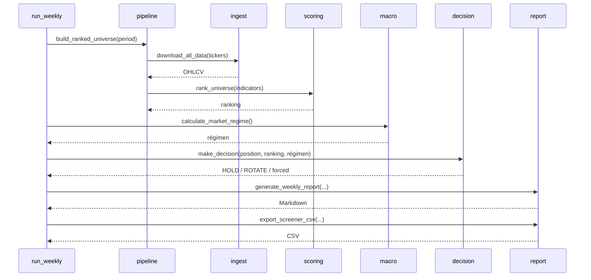

# Arquitectura

> Documento técnico en español. Las contribuciones de traducción al inglés son
> bienvenidas.

## 1. Propósito

El proyecto es un **pipeline batch semanal** que responde una pregunta:

> Dado un universo de 28 activos líquidos, una posición actual y el contexto de
> mercado, ¿conviene mantener la posición o rotar a otro activo?

No ejecuta órdenes. Genera una recomendación, un reporte y un screener para que
un operador humano tome la decisión.

## 2. Capas

```text
┌─────────────────────────────────────────────────────────────┐
│ Configuración   config/settings.yaml · config/universe.py  │
├─────────────────────────────────────────────────────────────┤
│ Datos           src/ingest.py · src/paths.py               │
├─────────────────────────────────────────────────────────────┤
│ Analítica       src/indicators.py · src/technicals_deep.py │
│                 src/scoring.py · src/macro.py              │
│                 src/earnings.py · src/news.py              │
│                 src/fundamentals.py                        │
├─────────────────────────────────────────────────────────────┤
│ Decisión        src/decision.py · src/risk.py              │
├─────────────────────────────────────────────────────────────┤
│ Contabilidad    src/accounting.py                          │
├─────────────────────────────────────────────────────────────┤
│ Presentación    src/report.py · src/narrative.py           │
│                 src/executive_report.py · templates/       │
├─────────────────────────────────────────────────────────────┤
│ Orquestación    src/run_weekly.py · src/pipeline.py        │
└─────────────────────────────────────────────────────────────┘
```

## 3. Módulos

| Módulo | Entrada | Salida | Notas |
| --- | --- | --- | --- |
| `config/loader.py` | `settings.yaml` | objeto config (singleton) | Acceso por notación de puntos. |
| `config/secrets.py` | `.env` + entorno | claves | No sobrescribe variables del sistema. |
| `config/universe.py` | — | lista de tickers | Fuente única del universo. |
| `src/paths.py` | — | rutas absolutas | Ancla todo a la raíz del repo. |
| `src/ingest.py` | tickers | `{ticker: DataFrame}` | Valida OHLCV y mínimo de filas. |
| `src/indicators.py` | DataFrame | DataFrame + dict de indicadores | Reemplaza NaN por defaults. |
| `src/technicals_deep.py` | DataFrame | MACD, ADX, BB, Supertrend, OBV | Indicadores avanzados. |
| `src/scoring.py` | dict de indicadores | score 0–100 + componentes | Pesos desde `settings.yaml`. |
| `src/macro.py` | yfinance / FRED | régimen + confianza | `RISK_ON`, `NEUTRAL`, `RISK_OFF`. |
| `src/earnings.py` | ticker + fecha | bool / fechas | Ventana lunes–viernes siguiente. |
| `src/news.py` | ticker | noticias + sentimiento | Finnhub / Marketaux opcionales. |
| `src/fundamentals.py` | ticker | métricas | Acciones vía Finnhub, ETFs vía yfinance. |
| `src/risk.py` | precio, ATR, ticker | stop, riesgo, idoneidad | Multiplicadores por categoría. |
| `src/decision.py` | posición + ranking + régimen | decisión | Motor único HOLD/ROTATE. |
| `src/accounting.py` | cartera | capital neto + fees | Comisión semanal o por rotación. |
| `src/report.py` | decisión + ranking + cartera | Markdown + CSV | Reporte semanal y screener. |
| `src/narrative.py` | portafolio | dossier dict | Datos para el reporte ejecutivo. |
| `src/executive_report.py` | dossier + ranking | Markdown | Jinja2 + decisión única. |
| `src/pipeline.py` | tickers | ranking + indicadores | Evita duplicar ingesta/scoring. |
| `src/run_weekly.py` | flags CLI | reportes | Orquestador. |

## 4. Flujo semanal



## 5. Contratos de datos

### 5.1 Indicadores (`get_latest_indicators`)

```python
{
    'date': '2026-10-16',
    'price': 200.0,
    'EMA9': 198.2,
    'EMA21': 195.4,
    'ATR14': 4.1,
    'RSI14': 61.2,
    'Ret1D': 0.3,
    'Ret5D': 1.1,
    'Ret20D': 4.1,
    'Vol20D': 22.5,
    'DistHigh20': -1.2,
    'DistLow20': 8.4,
    'VolRatio': 1.05,
    'ATRpct': 2.05,
    'AboveEMA21': True,
}
```

Todos los valores numéricos son `float` finitos; los NaN se sustituyen por
defaults seguros (`0`, `50` para RSI, `1.0` para volumen).

### 5.2 Fila del ranking

Contiene los indicadores anteriores más:

```python
{
    'ticker': 'AAPL',
    'score': 78.4,
    'momentum': 72.0,
    'trend': 85.0,
    'volatility': 90.0,
    'liquidity': 80.0,
    'regime': 75.0,
    'rank': 1,
}
```

### 5.3 Decisión

```python
{
    'action': 'HOLD'
    | 'ROTATE'
    | 'HOLD_WITH_WARNINGS'
    | 'ROTATE_TO_CASH_PROXY'
    | 'ROTATE_TO_STANDARD',
    'ticker': 'AAPL',  # HOLD
    'from_ticker': 'AAPL',  # ROTATE
    'to_ticker': 'NVDA',  # ROTATE
    'candidate': {...},  # ROTATE
    'reasons': ['...'],
    'details': {...},
}
```

`executive_report.determine_decision` normaliza las acciones forzadas a
`ROTATE` para la plantilla y conserva las razones originales.

## 6. Estado y artefactos

| Ruta | Versionado | Contenido |
| --- | --- | --- |
| `config/settings.yaml` | Sí | Parámetros. |
| `config/universe.py` | Sí | Universo. |
| `state/portfolio.json` | No | Posición, capital, historial, fees. |
| `data/raw/` | No | OHLCV descargado. |
| `output/` | No | Reportes, screener, dossier. |
| `.env` | No | Claves de API. |

El estado de cartera se crea desde `examples/portfolio.example.json`. El campo
`last_fee_week` hace idempotente la comisión semanal.

## 7. Manejo de fallos

- **Un ticker falla:** se registra un warning y se excluye del ranking; el resto
  continúa.
- **Sin claves de noticias:** `news.py` devuelve `[]` y el reporte muestra cero
  artículos.
- **Sin FRED:** `macro.py` usa el fallback de yfinance.
- **Sin portfolio:** `run_weekly` explica cómo crearlo y termina con código 1.
- **Red caída:** los tests offline no se ven afectados; el pipeline degrada el
  reporte, pero puede quedar sin régimen o sin fundamentales.
- **Error en el motor de decisión:** el reporte ejecutivo devuelve
  `HOLD_WITH_WARNINGS` en lugar de romperse.

## 8. Decisiones de diseño

1. **Un solo motor de decisión.** `src/decision.py` es la fuente de verdad;
   `executive_report.py` lo reutiliza. Evita reglas divergentes.
2. **Configuración antes que código.** Los parámetros numéricos viven en
   `settings.yaml`; no se hardcodean en funciones.
3. **Rutas ancladas a la raíz.** `src/paths.py` permite ejecutar desde cualquier
   directorio.
4. **Tests offline por defecto.** La red se marca como integración para que CI
   sea determinista.
5. **Secretos en cabeceras.** Finnhub recibe el token en `X-Finnhub-Token` para
   que no aparezca en URLs ni logs.
6. **Comisión configurable.** `weekly` o `rotation`, con idempotencia semanal.

## 9. Puntos de extensión

- **Nuevo indicador:** añadirlo en `indicators.py`, exponerlo en
  `get_latest_indicators` y usarlo en `scoring.py`.
- **Nuevo factor de scoring:** añadir peso en `settings.yaml` y una función
  `score_*`; actualizar `calculate_composite_score`.
- **Nuevo proveedor de datos:** crear un adapter con la misma interfaz que
  `download_ticker_data`.
- **Nuevo reporte:** consumir el dict de decisión y el ranking; no duplicar la
  lógica de decisión.
- **Backtesting:** reutilizar `calculate_all_indicators`, `rank_universe` y
  `make_decision` sobre ventanas históricas; añadir ejecución y costos.

## 10. Testing

| Nivel | Marcador | Red | Uso |
| --- | --- | --- | --- |
| Unitario / regresión | — | No | CI por defecto. |
| Integración | `@pytest.mark.integration` | Sí | Manual o job programado. |

Comando:

```bash
python -m pytest -q                    # offline
python -m pytest -q -m integration     # red
```

## 11. Seguridad

- `.env` nunca se versiona.
- `config/secrets.py` no sobrescribe variables de entorno existentes.
- Los logs de Marketaux no imprimen la URL (el token va en query string).
- Los tests de integración no se ejecutan en CI con secretos.
- Ver `SECURITY.md` para el reporte de vulnerabilidades.
